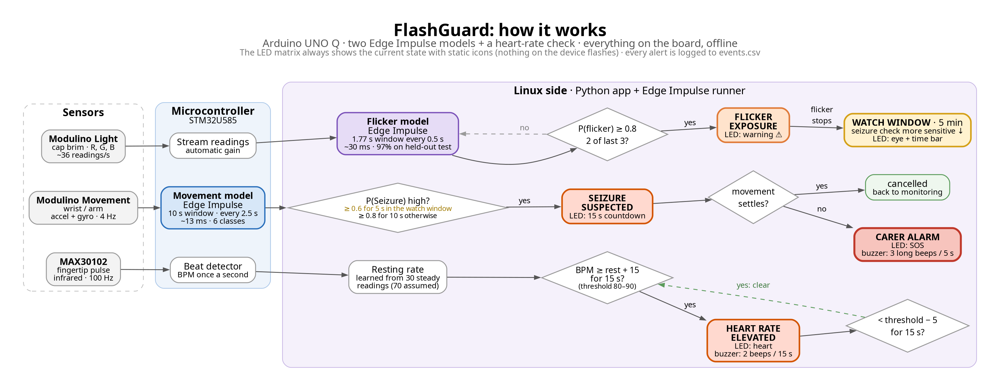
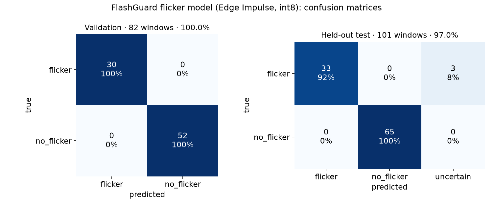
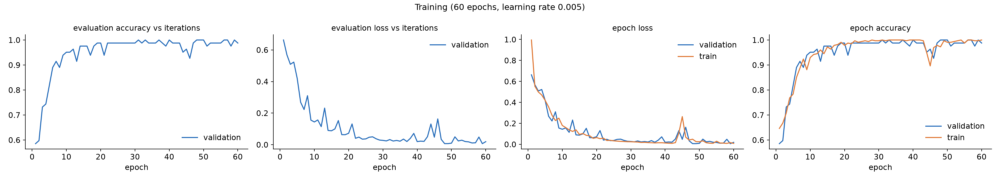
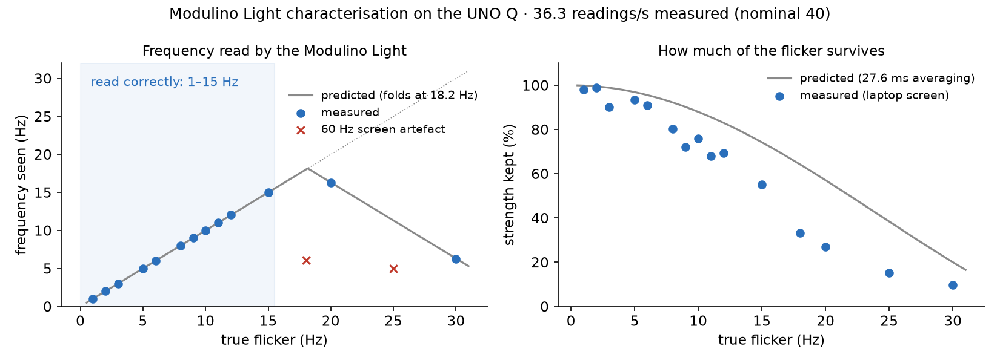
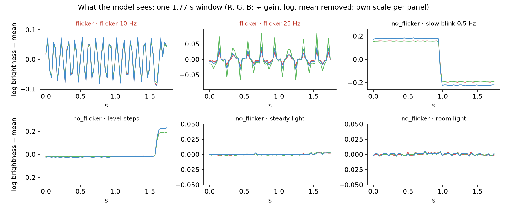
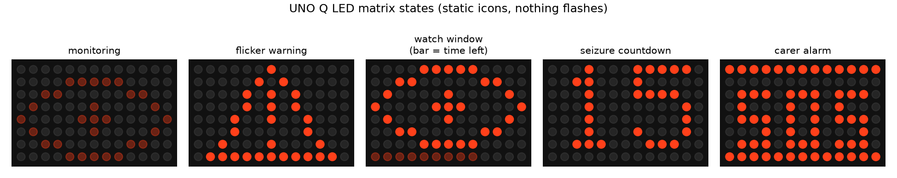
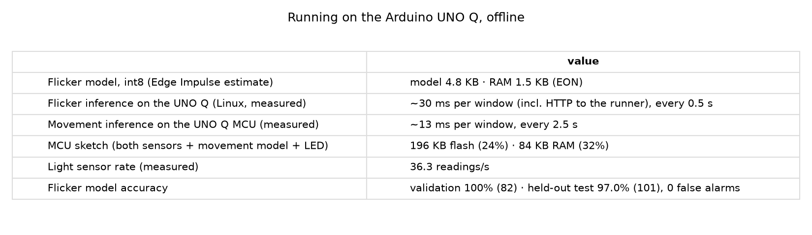

# FlashGuard results (for the presentation)

All figures are in [`docs/figures/`](figures/). The raw numbers are in
`figures/flicker_model_metrics.json`, from the Edge Impulse API for project 1170128 (FlashGuard).

| Figure | Shows | Talking point |
|---|---|---|
|  `7_flowchart.png` / `.svg` | How the current implementation works | Three sensors → microcontroller → Linux models → alerts. Flicker opens a 5 min watch window that makes seizure detection more sensitive; the heart-rate check runs alongside. Edit `7_flowchart.dot` and re-render with `dot -Tsvg` / `dot -Tpng -Gdpi=170` |
|  `1_flicker_model_confusion.png` | Flicker model confusion matrices, int8 | **97.0% on 101 held-out windows, zero false alarms.** The 3 misses are "uncertain", not wrong. 100% on validation (82) |
|  `2_flicker_model_training.png` | Training accuracy / loss per epoch | Converges in ~60 epochs; small dense network |
|  `3_light_sensor_response.png` | Modulino Light characterised on the board (screen sweep) | We measured the sensor's limits instead of assuming them: 36 readings/s, frequency correct 1–15 Hz, faster flicker folds exactly as predicted, but is still detected |
|  `4_model_input_examples.png` | What the model sees (1.77 s windows) | Log + mean removal makes it brightness- and distance-independent. Slow blinks, level steps, steady and room light are all `no_flicker` |
|  `5_led_matrix_states.png` | LED matrix states | Static icons only: a device for photosensitive users never flashes |
|  `6_on_device_numbers.png` | On-device numbers | Flicker model 4.8 KB (int8, Edge Impulse estimate); ~30 ms per check on the UNO Q; movement model ~13 ms on the MCU; everything offline |

Also in the repo:
- `hardware/light-test/light-test.pdf`: the test-rig schematic.
- `docs/RELEASE_v0.1.md`: what works.
- `docs/DESIGN_ISSUES.md`: problems found and solved, good for Q&A, e.g.:
  - the sensor runs 10% slow;
  - mains lighting folds to 8.6 Hz;
  - the Modulino library doesn't start on our board;
  - flashing only works from the laptop.

## Still to capture before presenting

1. **A demo video**, which is also the backup (spec §11). Show:
   - the flicker page at 10 Hz into the Modulino Light, in a dim room → warning triangle;
   - Esc → eye + time bar;
   - shaking the Movement module → countdown → SOS.

   Film the LED matrix and the screen together.
2. **Latency (T4):** count video frames from flicker onset to the triangle. Expected ~1–2 s
   (2 of 3 windows at 0.5 s steps).
3. **The events log** of that run: `tools/unoq pull` → `recordings/<app>/events.<time>.csv`.
4. **Edge Impulse Studio screenshots** (judges score the Edge Impulse integration):
   - Impulse design (Time series → Spectral Analysis → Classifier);
   - Feature explorer;
   - Model testing;
   - Deployment.

   Use project 1170128.
5. **The movement model's own results** from the teammate's project 1170305: confusion matrix,
   classes. We can't fetch them with our key.
6. **A photo of the wearable setup**: UNO Q, Modulino Light (forward-facing), Modulino Movement
   (wrist/arm).
7. **The honest limits** for the Q&A slide (`RELEASE_v0.1.md`):
   - one screen-based training session;
   - the Seizure class comes from acted movements;
   - no cancel button or vibration yet.
